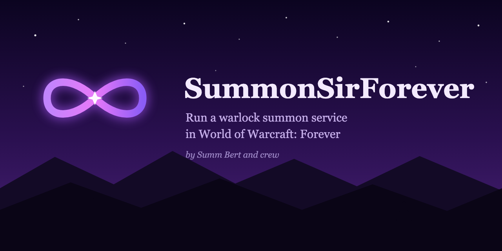

  
  
  

<b>One window, four tabs, the whole crew.</b> 
The warlock casts, the clickers click the portal, the advertiser posts in the city. Every character sees every tab.

<table align="center">
  <tr>
    <td align="center"> <b>Queue</b>: who is in line, who is NEXT, the summon buttons</td>
    <td align="center"> <b>Ledger</b>: gold per hour, open tabs, who never paid</td>
  </tr>
  <tr>
    <td align="center"> <b>Ads</b>: pick the channels, see the ad, one click posts it</td>
    <td align="center"> <b>Setup</b>: pick a role, each check turns green when done</td>
  </tr>
</table>

## Install (3 min)
1. Download the zip from the [latest release](https://github.com/travv/SummonSirForever/releases/latest).
2. Extract it into `_forever_\Interface\AddOns\`. You should end up with `AddOns\SummonSirForever\SummonSirForever.toc`.
3. Fully restart WoW. A `/reload` is not enough for a new addon.
4. Had SteaSummonForever installed? Delete that folder. The two cannot run side by side.

`/ssf` opens the window. `/ssf help` lists every command.

## First run
The window opens on the **Setup** tab the first time each character logs in. Pick what this window does; the next page checks that role's setup for you, green when done, orange with the menu path when not.

| Role | Who | The setup page checks |
|---|---|---|
| **Warlock** | the character that casts Ritual of Summoning | destination, price, your **Summon Next** key |
| **Clicker** | anyone at the destination to click the portal | sound plays in the background (the cue), the optional Interact key |
| **Advertiser** | a character parked in a city | which channels the ad posts to, one checkbox each |

Rerun it any time from the Setup tab or `/ssf setup`.

## How a sale works
1. A player whispers the warlock "123", "summon sm" or "wtb sumon pls" (typos are fine). They get a group invite, nothing else: the invite is the notification and your ad already quoted the price. People who ask for the wrong place get a short reply instead.
2. When they join they appear on the **Queue** tab. The first person waiting is marked **NEXT** in green.
3. Press your **Summon Next** key, the Next button, or the big Summon Next button. They get "Summoning you now, sir.", the row reads **Casting**, and every clicker window plays the raid-warning sound and shows a **PORTAL UP** banner with a 30 second bar.
4. The clickers click the portal. The row reads **Portal up**, then **Arrived**.
5. The customer trades you. Any amount counts (a discount is still a payment): coin sound, one "paid:" line in chat, ledger updated. No payment within 10 minutes puts them on the never-paid list and blocks them for 24 hours; paying later lifts it.

## The tabs

**Queue.** Header: where you stand, where you summon to (click to pin where you stand), your soul shards, `Clickers 2   Raid 7/40` (orange near 35, red at 39: invites fail at 40). Buttons: Next, AFK, Ad, Menu, every one with a tooltip. Rows: X removes (no charge), click a name to summon that person now, right-click to move, remove, block or whisper. Status words: Waiting, Casting, Portal up, Arrived, Declined, Offline, Dead.

**Ledger.** The session in large type: summons, gold, gold per hour, percent paid. **Open tabs** lists everyone who arrived and has not paid, with **Paid** (mail, a friend paid, a comp) and **Block** buttons; red past the grace time. Then 7 days and 8 weeks of history. **Options** opens the settings.

**Ads.** One checkbox per chat channel this character has joined (default General, Trade, Services, LookingForGroup). The ad as it will read, then **Post ad**: once to each checked channel, then a cooldown. Nothing posts on its own. On an advertiser the button reads "Waiting for warlock" until the destination and price have synced.

Default ad: `WTS summon {dest} {price}. {blurb} PST "inv" {spell}`. `{blurb}` fits the spot (Scarlet Monastery: "Skip the run through Tirisfal.", Booty Bay: "Flight path, neutral AH, Stranglethorn quests."), `{spell}` is the clickable [Ritual of Summoning] link.

**Setup.** The walkthrough above. Leaving the tab counts as done.

## Also on screen
- **Big Summon Next button** (warlock): who is next, how many in line, your shards, your key. Green while casting, red when out of shards, "Life Tap" when low on mana.
- **PORTAL UP banner** (clickers): the raid-warning sound is the cue to look at that window. Turn on "hear it in the background" on the Setup tab so it plays while another window has focus.
- **Chat:** one "SummonSir:" line per payment, drop and ignored (blocked) whisper. A ping when someone joins the queue and the coin sound on payment, both toggles.

## Messages
Short, "sir" once, no exclamation points. Sent only to people who whispered you first:

| When | Default |
|---|---|
| Someone asks | invite only (optional reply under Options > Messages) |
| You cast | "Summoning you now, sir." |
| They land | nothing (optional reminder: a checkbox on the warlock setup page) |
| Wrong place, queue full, already here, AFK | one short line |

<b>Commands</b> (click to open)

| Command | Does |
|---|---|
| `/ssf` | Open the window on the Ledger tab (`/sw` still works) |
| `/ssf tab queue\|ledger\|ads\|setup` | Open the window on a tab |
| `/ssf help` | List every command |
| `/ssf options` | Settings page |
| `/ssf setup` | The setup walkthrough |
| `/ssf role warlock\|clicker\|advertiser` | What this window does |
| `/ssf dest <name>` / `dest list` / `dest clear` | Destination for ads and replies |
| `/ssf price <amount> [dest]` | Price: `1` (gold), `80s`, `1g50s`; optional per destination |
| `/ssf block <name> [30m\|24h\|7d\|perm]` / `unblock` / `blocklist` | Blocklist |
| `/ssf paid <name> [amount]` | Mark a summon paid by hand |
| `/ssf today` | Today's summons and gold by hour |
| `/ssf service on\|off` | Auto-invite on or off |
| `/ssf cap <n>` | Queue cap for new customers (0 = none) |
| `/ssf plain on\|off` | Plain messages instead of the SummonSir lines |
| `/ssf say <type>` | Print a sample message |
| `/ssf big on\|off\|reset` | Big Summon Next button |
| `/ssf clear` | Clear the whole queue (asks first) |
| `/ssf adtext <template>` / `channels <list>` / `lock <name>` | Ad text, ad channels, main warlock's name |
| `/ssf testportal` | Preview the clicker banner |
| `/ssf queuedebug` | Queue state for bug reports |

## Ground rules
- Nothing here presses keys, clicks, or keeps you online.
- Ads go out only when you click, once per channel per click.
- The addon only whispers people who whispered you first.
- Service data is saved per WoW account in `SteaWarlockDB`.

Bug reports: turn on `/console scriptErrors 1`, and for queue problems paste `/ssf queuedebug`.

---

Forked from [SteaSummonForever](https://github.com/edualve/SteaSummonForever) (MIT). The original raid-summon features still work; their README is in [docs/ORIGINAL-README.md](./docs/ORIGINAL-README.md).
