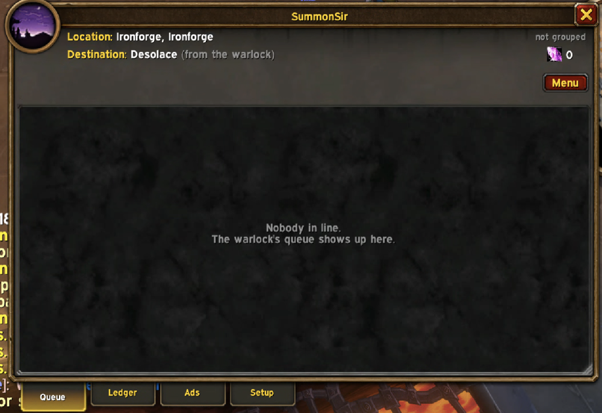
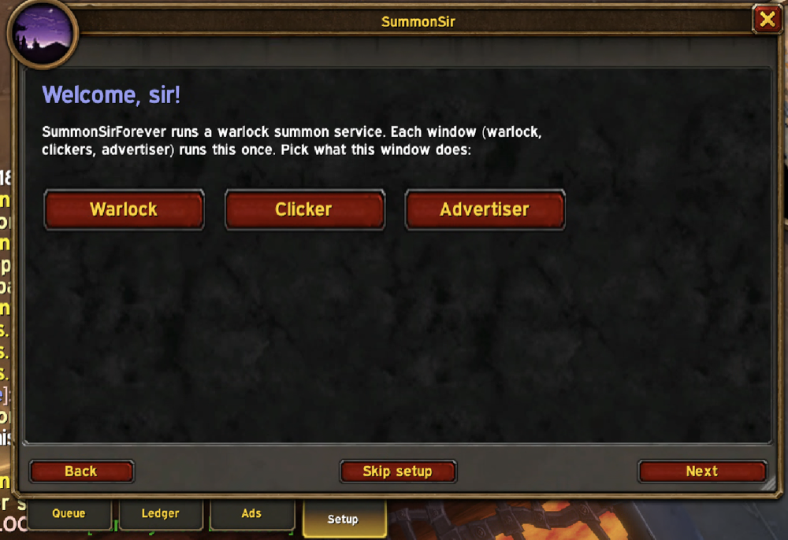
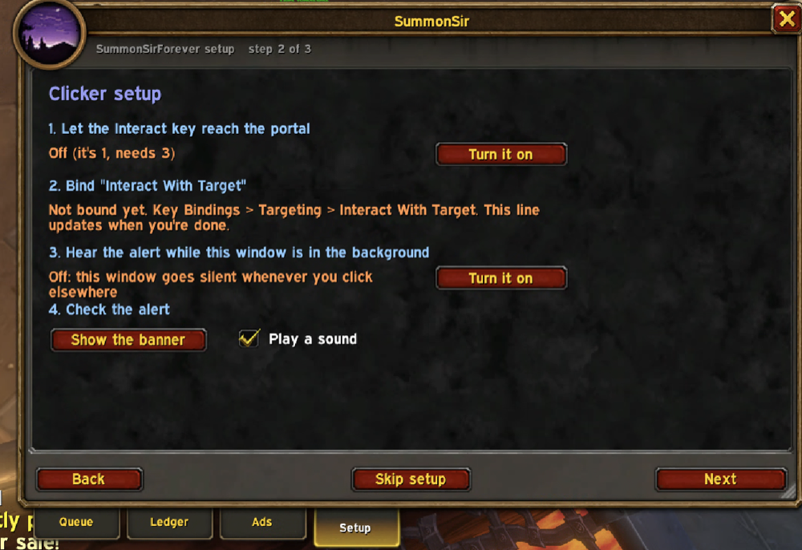
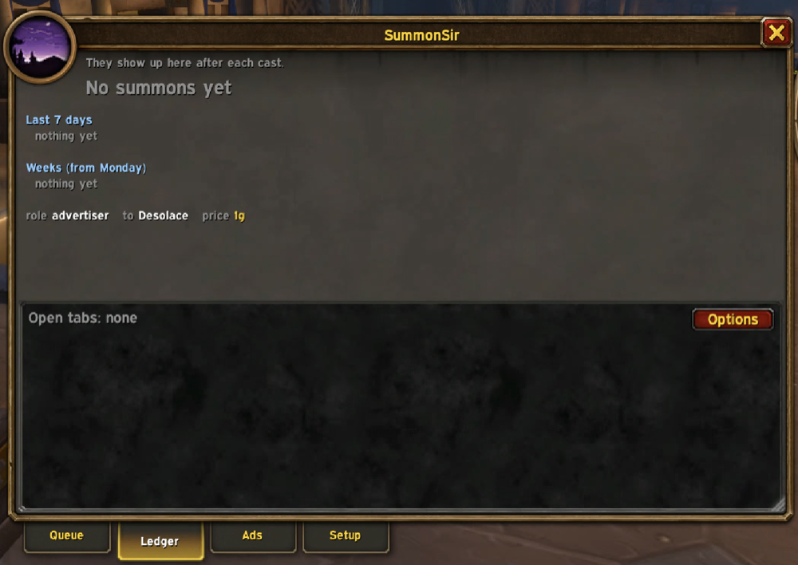
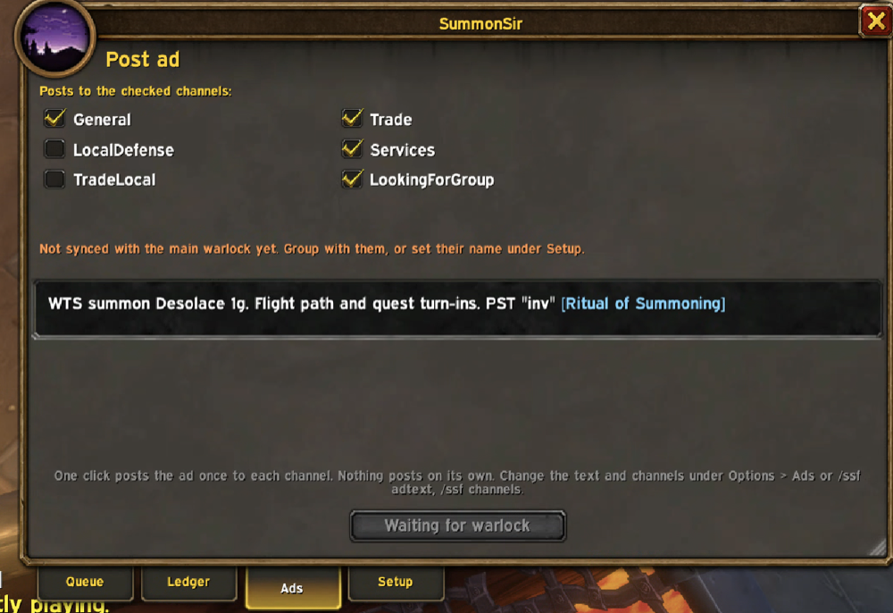

# SummonSirForever

A warlock summon-service addon for WoW: Forever. One window with four tabs runs the whole crew: the warlock who casts, the clickers who click the portal, and the advertiser who posts in the city. Forked from [SteaSummonForever](https://github.com/edualve/SteaSummonForever) (MIT); the original raid-summon features still work and are documented further down.

## Install (3 min)
1. Download the zip from the [latest release](https://github.com/travv/SummonSirForever/releases/latest).
2. Extract it into `_forever_\Interface\AddOns\`. You should end up with `AddOns\SummonSirForever\SummonSirForever.toc`.
3. Fully restart WoW. A `/reload` is not enough for a new addon.
4. Had SteaSummonForever installed? Delete that folder. The two cannot run side by side.

Type `/ssf` in chat to open the window. `/ssf help` lists every command.

## First run: the Setup tab (1 min per character)
The window opens on the **Setup** tab the first time each character logs in. Pick what this window does, and the next page checks that role's setup for you: green means done, orange tells you where to click.

| Role | Who | The setup page checks |
|---|---|---|
| **Warlock** | the character that casts Ritual of Summoning | destination, price, that your **Summon Next** key is bound |
| **Clicker** | anyone standing at the destination to click the portal | sound plays while the window is in the background (this is the cue), plus the optional Interact key setup |
| **Advertiser** | a character parked in a city | which chat channels the ad posts to, with Join buttons for any you have not joined |

Every tab is visible to every role, so a clicker can read the ledger and the advertiser can watch the queue. Rerun setup any time from the Setup tab or `/ssf setup`.

## How a sale works
1. A player whispers the warlock anything like "123", "summon tb" or "wtb sumon pls" (typos are fine). They get one reply with the price and an invite. People who ask for the wrong city get a polite no instead.
2. When they join the group they appear on the **Queue** tab with their place in line. The first person waiting is marked **NEXT** in green.
3. Press your **Summon Next** key, the Next button, or the big Summon Next button. The row turns to **Casting**, the group hears who is coming, and **every clicker window plays the raid-warning sound and shows a PORTAL UP banner** with a 30-second bar. The sound is the cue to look at that window.
4. The clickers click the portal (or press Interact With Target if they set that up). The row reads **Portal up**, then **Arrived** when the customer takes it.
5. The customer trades you. The payment lands in the ledger with a coin sound and one "paid:" line in chat. If they arrive and do not pay within 10 minutes they go on the never-paid list and are blocked for 24 hours (paying later lifts it).

## The tabs

### Queue
- **Header:** where you stand, where you summon to (click the line to pin where you stand, click again to clear), your soul shards, and `Clickers 2   Raid 7/40`. The raid count goes orange near 35 and red at 39, because invites fail silently at 40.
- **Buttons:** Next (the keybound cast), AFK (pause auto-invites; whispers get an AFK reply), Ad (post the ad from the warlock), Menu. Everything has a tooltip.
- **Rows:** X removes someone (no charge). Click a name to summon that person now. Right-click a name to move them to the front or back, remove, block, or whisper them any of the stock messages. Status words: Waiting, Casting, Portal up, Arrived, Declined, Offline, Dead.
- An empty queue says so. Customers who leave the group are dropped at once; customers offline for 5 minutes are dropped (setting).

### Ledger

- The session headline in large type: summons, gold, gold per hour, percent paid.
- **Open tabs:** everyone who arrived and has not paid yet, with **Paid** (mail, a friend paid, a comp) and **Block** buttons. Past the grace time the row turns red and reads "never paid".
- Last 7 days and the last 8 weeks (Monday to Sunday), scrolling.
- **Options** opens the settings page.

### Ads

- One checkbox per chat channel this character has joined: tick the ones the ad goes to (default: General, Trade, Services, LookingForGroup). Then the sync state with the warlock, and the ad exactly as it will read.
- **Post ad** posts once to each channel, then counts down the cooldown. Nothing posts on its own. On an advertiser the button reads "Waiting for warlock" until the warlock's destination and price have synced (group with them, or set their name in Setup).
- Default ad: `WTS summon {dest} {price}. {blurb} PST "inv" {spell}`. `{blurb}` is a short line that fits the destination (Scarlet Monastery: "Skip the run through Tirisfal.", Booty Bay: "Flight path, neutral AH, Stranglethorn quests."), and `{spell}` is a clickable [Ritual of Summoning] link.
- An advertiser with assist in the warlock's raid invites "inv" whisperers itself and puts them in the warlock's queue.

### Setup
The walkthrough described above. Leaving the tab counts as done.

## Also on screen
- **Big Summon Next button** (warlock): who is next, how many are in line, your shards, your keybind. Turns green while casting, red when out of shards, "Life Tap" when low on mana. Clear empties the queue (asks first).
- **PORTAL UP banner** (clickers): the raid-warning sound plays whenever the warlock starts a summon, so a clicker running several windows knows which one to look at. The banner names who is being summoned, shows a bar that drains while the portal is up, and names your Interact key if you bound one. Turn on "hear it in the background" on the Setup tab so the sound plays while another window has focus. Soft interact (Interact With Target reaching the portal) is optional and did not work reliably for us; clicking the portal is fine.
- **Chat:** one "SummonSir:" line for each payment, drop, and ignored (blocked) whisper. A ping when someone joins the queue, the coin sound on payment; both are toggles.

## Settings
Everything is on the **Summon service** page under **Settings > AddOns > SummonSirForever** (`/ssf options`): role, window behavior, destination and prices per destination, queue cap, every message type (random line, a fixed line, your own text, or off; plus a plain mode), never-paid timing and auto-block, ad text and channels, alerts and sounds.

## Commands
| Command | Does |
|---|---|
| `/ssf` | Open the window on the Ledger tab (`/sw` still works) |
| `/ssf tab queue\|ledger\|ads\|setup` | Open the window on a tab |
| `/ssf help` | List every command |
| `/ssf options` | Settings page |
| `/ssf setup` | The setup walkthrough |
| `/ssf role warlock\|clicker\|advertiser` | What this window does |
| `/ssf dest <name>` / `dest list` / `dest clear` | Destination for ads and replies |
| `/ssf price <amount> [dest]` | Price: `1` (gold), `80s`, `1g50s`; optional per destination |
| `/ssf block <name> [30m\|24h\|7d\|perm]` / `unblock` / `blocklist` | Blocklist |
| `/ssf paid <name> [amount]` | Mark a summon paid by hand |
| `/ssf today` | Today's summons and gold by hour |
| `/ssf service on\|off` | Auto-reply and invite on or off |
| `/ssf cap <n>` | Queue cap for new customers (0 = none) |
| `/ssf plain on\|off` | Plain messages instead of the SummonSir lines |
| `/ssf say <type>` | Print a sample message |
| `/ssf big on\|off\|reset` | Big Summon Next button |
| `/ssf clear` | Clear the whole queue (asks first) |
| `/ssf adtext <template>` / `channels <list>` / `lock <name>` | Ad text, ad channels, main warlock's name |
| `/ssf testportal` | Preview the clicker banner |
| `/ssf queuedebug` | Queue state for bug reports |

## Ground rules
- Nothing here presses keys, clicks, or keeps you online.
- Ads go out only when you click, once per channel per click.
- The addon only whispers people who whispered you first.
- Service data is saved per WoW account in `SteaWarlockDB`. The original addon's per-character settings are untouched.

Bug reports: turn on `/console scriptErrors 1`, and for queue problems paste `/ssf queuedebug`.

---

## Original SteaSummonForever README

***FAN UPDATE FOR WORLD OF WARCRAFT: FOREVER***

WoW: Forever (Classic+) addon for warlock raid summoning

I am not the original author of this addon but was a huge fan so wanted to bring it to WoW: Forever. This is a continuation of my Season of Discovery fork ([SteaSummonSOD](https://github.com/edualve/SteaSummonSOD)), which itself built on the Wrath update by TheGeneticsGuy:
[Fan Update for Wrath by TheGeneticsGuy](https://github.com/TheGeneticsGuy/Unofficial_SteaSummon)

## Installing
(For this fork, use the install steps at the top: the folder is `SummonSirForever`.)

## New

Manage your raid while summoning, relinquish raid lead when done summoning and leave the raid with raid roles in preferred state

Alt management: allows raiders to be on an alt so their buffs are not ticking, whispers when they are near the top of the list

Auto life tap: the Next button becomes a life tap button when out of mana for summon

## One button summoning, shared summoning list...

Click one button to summon the next raider on the priority based list. **That** button. No other buttons.
Just keep clicking **that** button. Nothing to read, nothing else to do. If you want to summon further down the list,
you can do that too. If you don't like to click, make a key bind. List all done? The button goes away, or the whole
window depending on your config. Not a Warlock? Make your warlocks get **that button** too, and you can start the summon list before they ever log on.

Features a minimal interface that gets out of your way while providing simple, easy, summoning for your whole raid.
Warlocks who have the addon share the same summon list with status updates to drive the one button summoning. Raiders
also have the benefit of seeing their place on the summon list while helping to keep the list alive.

Constant status updates distributed to the raid keeps the list current and informative. Know at a glance which raiders
have requested summons, which have a summon on its way, which have a successful summon awaiting acceptance, who's dead,
who's offline, who has world buffs... Strong, durable network code ensures that all raiders have the current list, the
*same* list, in the *same* order, with the *same* people on it. Logged on half way through the raid summon? Your list
is the *raid* list, with all the status intact.

## Raider self management

When your raiders type a summon phrase e.g. 123, they get added to the global summoning list shared by everyone in
your raid using the addon. When they type -123, they remove themselves, and if they have the addon they can just click
the x next to their name. If they didn't accept a summon they can reset their status by typing the summon phrase again,
without losing their place in the list. Players are removed from the summon list when they actually show up at the
destination, even if on foot.

Your raid can't learn 123? That's fine, you get to configure a list of all the dumbest summon requests you can think of.
That is, if you can think of something not already on the default list. Don't worry, your raid will help with that.

## Alt Support

Your summon list is long and the buffs are ticking. SteaSummon will whisper your raid members who are a ways down the list and tell them to whisper back an alt name and log off. The alts get whispered when the player's main gets near the top of the summon list.

## Raid Management

Warlocks often end up starting the raid to get it moving to the raid location. You can configure SteaSummon to manage the raid until the raid lead turns up or summons are over (whichever is configured). When handing over lead you can have Steasummon set up the raid the way your raid leader likes it, with assists and ML already set.

## Configuration

Most things are configurable

* summon trigger phrases
* summon communications through raid, whisper, and say
* summon list priorities (warlock, world buffs, named players)
* window scaling
* summon list save time (for relogging as the last add-on user in raid)
* key binds (Main Menu / Key Bindings / AddOns), never take your eyes off the movie
* alt management
* raid management
* turn off summon list sync (but who would want to do that? Really, who? I want their names and addresses.)

## Resources

If you can help translate this addon into other languages, create a localization file like the one in ./Locale and send me a pull request on GitHub. I like those.

For issues, feature requests, and straight up bugs, please use GitHub issues on this repository.

## More Pictures

